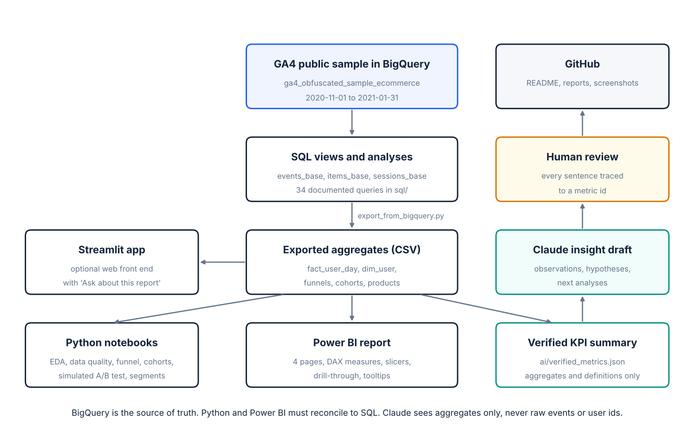

# ProductPulse AI

**AI-assisted product analytics and customer retention intelligence for an ecommerce store.**
An end-to-end analysis of the public Google Analytics 4 ecommerce sample: BigQuery SQL for metrics, Python for validation and statistics, Power BI for the interactive report, and a Claude-assisted insight workflow in which every sentence is traced to a verified number.

> New to this folder? Open [`START_HERE.md`](START_HERE.md).

| Executive overview | Conversion funnel |
|---|---|
|  |  |
| **Retention and cohorts** | **Products and acquisition** |
|  |  |

## 1. Business problem

An ecommerce product team collects millions of interaction events but has no single trusted view of the customer journey. The team needs to know where users leave the path to purchase, whether that differs by device and acquisition channel, whether users come back, and which products deserve a closer look.

**Who it is for**

| Persona | Need |
|---|---|
| Product manager | Find friction points and decide what to investigate first |
| Growth / marketing analyst | Compare acquisition channels and what users do afterwards |
| Product analyst | Measure funnels, cohorts and retention with clear definitions |
| Leadership | A short, trustworthy view of product performance |

**Questions answered**

1. How many users and sessions are in the period?
2. How do users progress from product view to cart, checkout and purchase?
3. Which funnel step has the largest drop-off?
4. How do funnel metrics differ by device, traffic source and country?
5. How does repeat activity vary by first-observed month?
6. Which products attract views, and which are associated with purchases and revenue?
7. Which segments show low or declining observed activity?
8. What should a product manager investigate next, and what evidence supports it?

## 2. Dataset

| | |
|---|---|
| Source | `bigquery-public-data.ga4_obfuscated_sample_ecommerce` (Google Merchandise Store, GA4 export) |
| Period | 2020-11-01 to 2021-01-31 (92 daily tables, `events_YYYYMMDD`) |
| Grain | One row per event, with nested `event_params` and `items` arrays |
| Access | Free with a Google account through the BigQuery sandbox. See [`data/README.md`](data/README.md) |
| Not included here | The raw data. Only the SQL to reproduce it is committed |

**Limitations that shape every result.** The sample is historical and obfuscated: some values are replaced with `<Other>`, `(data deleted)` or `(not set)`. It covers three months, so "new" users are only new *to the sample* and late cohorts cannot be followed for long. It is observational, so it can show what happened and where, never why. Full list: [`reports/limitations.md`](reports/limitations.md).

## 3. Architecture



| Layer | Tool | What lives there |
|---|---|---|
| Source of truth | BigQuery SQL | 3 views, 34 documented queries, 12 export queries |
| Validation and statistics | Python (pandas, SciPy, matplotlib, seaborn) | 6 notebooks, reusable KPI functions |
| Interactive report | Power BI | 4 pages, 42 explicit DAX measures, slicers, cohort heatmap |
| Optional web report | Streamlit | Same four pages plus "Ask about this report" |
| Insight drafting | Claude | Summaries of verified aggregates, reviewed by a person |
| Publishing | Git and GitHub | Code, documentation, screenshots |

Data flow in detail: [`docs/data_flow.md`](docs/data_flow.md).

## 4. Metric definitions

Every KPI has a written definition, numerator, denominator, grain, filters, null handling, SQL reference and limitations in [`docs/metric_definitions.md`](docs/metric_definitions.md). The three that matter most:

| Metric | Numerator | Denominator | Unit |
|---|---|---|---|
| User purchase conversion | Distinct users with at least one purchase event | Distinct active users, same period and filters | User |
| Funnel step conversion (stage presence) | Users who fired the later event at least once | Users who fired the earlier event at least once | User |
| Monthly activity retention | Cohort users with any event in month N | All users first observed in the cohort month | User |

Events, sessions and users are different units and are never mixed in one number.

## 5. SQL methodology

| File | Queries | Purpose |
|---|---|---|
| [`00_create_views.sql`](sql/00_create_views.sql) | 3 views | `events_base` (event grain), `items_base` (item grain), `sessions_base` (session grain) |
| [`01_schema_exploration.sql`](sql/01_schema_exploration.sql) | Q01 to Q06 | Date range, event names, parameter keys and types, dimension values, item array |
| [`02_data_quality.sql`](sql/02_data_quality.sql) | Q07 to Q13 | Nulls, duplicates, timestamps, purchase and revenue validation, UNNEST fan-out |
| [`03_event_metrics.sql`](sql/03_event_metrics.sql) | Q14 to Q18 | Daily and monthly KPIs, new users, session engagement, rolling averages |
| [`04_funnel_analysis.sql`](sql/04_funnel_analysis.sql) | Q19 to Q22 | User-level stage-presence funnel, sequential session funnel, time between stages |
| [`05_cohort_retention.sql`](sql/05_cohort_retention.sql) | Q23 to Q26 | Monthly and weekly cohorts, repeat activity, repeat purchase |
| [`06_product_analysis.sql`](sql/06_product_analysis.sql) | Q27 to Q30 | Product and category performance, low-conversion items, order size |
| [`07_segment_analysis.sql`](sql/07_segment_analysis.sql) | Q31 to Q34 | Channel, country, funnel by segment, rule-based engagement segments |

Techniques used: CTEs, conditional aggregation, window functions (`ROW_NUMBER`, `MIN ... OVER`, `LAG`, `FIRST_VALUE`, `RANK`, rolling frames), scalar sub-queries over `UNNEST(event_params)` so parameters cannot multiply rows, and de-duplication of orders by `transaction_id`.

Example: the sequential session funnel adds one stage timestamp per CTE, so a stage counts only if it happened at or after the previous one in the same session.

```sql
s2 AS (
  SELECT *,
    MIN(IF(event_name = 'add_to_cart' AND event_timestamp >= t_view, event_timestamp, NULL))
      OVER (PARTITION BY user_pseudo_id, ga_session_id) AS t_cart
  FROM s1
)
```

## 6. Python notebooks

| Notebook | What it does |
|---|---|
| [`01_data_exploration`](notebooks/01_data_exploration.ipynb) | Shape, types, date coverage, event distribution, daily trends, user mix |
| [`02_data_quality`](notebooks/02_data_quality.ipynb) | 27 PASS / REVIEW / FAIL checks on keys, dates, categories, revenue and outliers, with documented decisions |
| [`03_funnel_analysis`](notebooks/03_funnel_analysis.ipynb) | Both funnels, reconciliation with SQL, device and channel comparison with confidence intervals |
| [`04_cohort_retention`](notebooks/04_cohort_retention.ipynb) | Cohort heatmap reconciled with SQL, a fixed 30-day return window, segment comparison |
| [`05_ab_test_simulation`](notebooks/05_ab_test_simulation.ipynb) | **Simulated** checkout experiment: sample size, SRM check, z-test, interval, guardrail |
| [`06_engagement_segmentation`](notebooks/06_engagement_segmentation.ipynb) | Transparent activity features, rule-based segments, declining-activity indicator |

Notebooks 03 and 04 stop with an error if Python and SQL disagree.

## 7. Power BI report

Four pages, each with a slicer row for date, device, channel and country: **Executive overview**, **Conversion funnel**, **Retention and cohorts**, **Products and acquisition**. File: `powerbi/ProductPulse.pbix`.

- Star-style model: `dim_user` and `dim_date` filter `fact_user_day` (one row per user per day), so distinct users are correct under any combination of slicers.
- 42 explicit DAX measures in [`powerbi/measures.dax`](powerbi/measures.dax); no implicit sums.
- Reconciled to SQL with no filters: 270,154 active users, 4,451 validated orders, 1.64% user purchase conversion, $308,200 revenue; funnel counts 61,252 / 12,545 / 9,715 / 4,419; cohort month-1 retention 5.9% (Nov) and 2.5% (Dec).
- The cohort heatmap leaves unobserved months blank rather than showing 0%.
- Theme: [`powerbi/theme.json`](powerbi/theme.json). Build steps: [`powerbi/BUILD_GUIDE.md`](powerbi/BUILD_GUIDE.md).
- Not built yet: slicer sync across pages, drill-through, tooltip page, bookmarks and reset button (BUILD_GUIDE step 7).

Refresh: re-run `scripts/export_from_bigquery.py`, then Home > Refresh in Power BI Desktop.

## 8. AI insight workflow

Claude drafts; a person verifies. The assistant receives only [`ai/verified_metrics.json`](ai/) (aggregates with numerator, denominator, segment, definition and caveat) and must return observations, hypotheses labelled "unproven", next analyses and limitations.

1. `scripts/build_metric_summary.py` builds the metric file from the exports.
2. `scripts/ask_claude.py` (or the Streamlit panel) sends the fixed prompt in [`ai/prompts.md`](ai/prompts.md).
3. Every sentence is checked against five rules and logged in [`ai/insight_validation.md`](ai/insight_validation.md): number, period, denominator, fact vs hypothesis, recommendation.
4. Only kept or corrected sentences reach the executive summary.

## 9. Key findings

All values: full sample, 2020-11-01 to 2021-01-31, 270,154 users. Source for each number: [`reports/kpi_snapshot.md`](reports/kpi_snapshot.md).

| # | Finding | Value | Numerator / denominator | SQL |
|---|---|---|---|---|
| 1 | User purchase conversion | 1.64% | 4,419 purchasers / 270,154 active users | Q19 |
| 2 | Largest funnel step drop-off: View item to Add to cart | 79.52% did not continue | 48,707 / 61,252 users | Q19 |
| 3 | Cart-to-checkout, desktop vs mobile | 77.05% vs 77.85% (no evidence of a gap: difference +0.80 points, 95% CI -0.70 to +2.30) | 5,600 / 7,268 vs 3,898 / 5,007 users | Q20 |
| 4 | Month-1 activity retention, November and December cohorts | 5.86% and 2.53% | 4,651 / 79,421 and 2,517 / 99,664 users | Q23 |
| 5 | Users active on one day only | 89.00% | 240,441 / 270,154 users | Q25 |

Totals for the period: 4,451 validated orders and $308,200 revenue (de-duplicated by transaction id). The user-level and sequential session funnels disagree sharply on cart-to-checkout (77.44% of users vs 35.71% of sessions), which is flagged as an open investigation rather than explained.

Recommended investigations are in [`reports/executive_summary.md`](reports/executive_summary.md). This project analyses a public historical sample. It does not claim to have improved any company's conversion or retention; measuring impact would need a real experiment (design shown in [`reports/experiment_memo.md`](reports/experiment_memo.md), on simulated data).

## 10. Reproduce it

```bat
python -m venv .venv
.venv\Scripts\activate.bat
pip install -r requirements.txt

python scripts\export_from_bigquery.py --project YOUR_PROJECT_ID
python scripts\build_metric_summary.py
jupyter lab
streamlit run app\streamlit_app.py
```

Requirements: Python 3.10 or newer, a Google account for BigQuery, Power BI Desktop (Windows) for the report. No API key is needed unless you want live Claude answers. No credentials are stored in this repository.

Without BigQuery access, `python scripts/make_demo_data.py` creates **synthetic** tables in `data/demo/` so the code can be run. Those numbers are invented and are labelled as such everywhere they appear.

## 11. Repository layout

```
ProductPulse-AI/
├── README.md  START_HERE.md  LICENSE  requirements.txt  .gitignore  .env.example
├── sql/            00_create_views.sql, 01 to 07 analysis files, exports/
├── scripts/        export_from_bigquery.py, build_metric_summary.py, ask_claude.py, make_demo_data.py
├── productpulse/   data.py, metrics.py, charts.py, insights.py
├── notebooks/      01 to 06
├── app/            streamlit_app.py
├── powerbi/        theme.json, measures.dax, BUILD_GUIDE.md, ProductPulse.pbix, screenshots/
├── ai/             prompts.md, insight_validation.md, verified_metrics.json
├── reports/        executive_summary.md, experiment_memo.md, limitations.md, kpi_snapshot.md
├── docs/           architecture.png, metric_definitions.md, data_flow.md, qa_checklist.md, interview_prep.md
└── data/           README.md, data_dictionary.md, samples/, demo/ (synthetic), exports/ (git-ignored)
```

## 12. Future improvements

- A longer date range, to follow cohorts for more than two months and to define a defensible future-outcome label for an activity model.
- Session-level traffic source from `event_params` (`source`, `medium`, `campaign`) to move beyond first-touch attribution.
- Days from first cart to first purchase, to size cross-session buying.
- Connect Power BI to BigQuery directly instead of CSV exports.
- A real randomized test of the checkout hypothesis.

## Licence and data terms

Code and documentation: MIT ([`LICENSE`](LICENSE)). The GA4 sample belongs to Google and is used under its public dataset terms; it is not redistributed here.