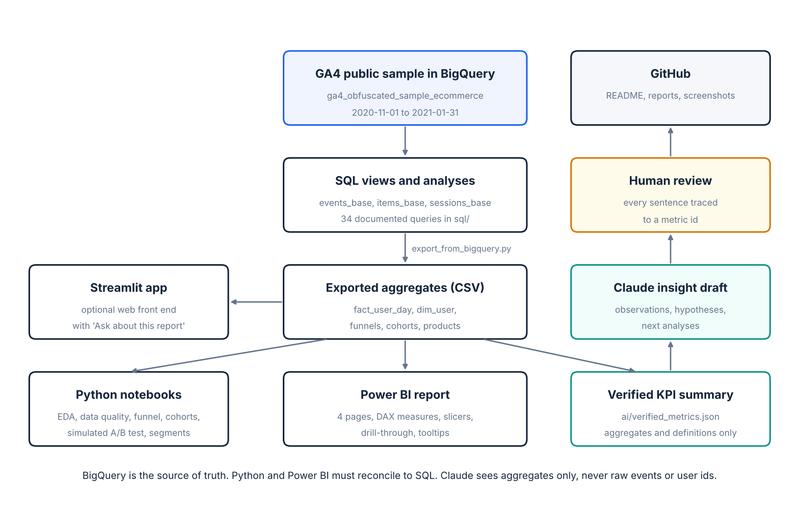

# Data flow

How a number travels from the public dataset to a sentence in a report, and where it is checked on the way.



## Steps

| # | Step | Tool | Input | Output | Check at this step |
|---|---|---|---|---|---|
| 1 | Explore the schema | BigQuery | `events_*` | Notes in `data/data_dictionary.md` | Date range and event names match expectations (Q01, Q02) |
| 2 | Create views | BigQuery | `sql/00_create_views.sql` | `events_base`, `items_base`, `sessions_base` | Row count of `events_base` equals the filtered source |
| 3 | Data quality | BigQuery | `sql/02_data_quality.sql` | Counts of nulls, duplicates, invalid purchases | Each issue gets a written handling rule |
| 4 | Analyse | BigQuery | `sql/03` to `07` | Query results | A validation query for each major metric |
| 5 | Export | `scripts/export_from_bigquery.py` | `sql/exports/*.sql` | 12 CSV files in `data/exports/` | Bytes scanned printed; `--dry-run` available |
| 6 | Validate in Python | Notebooks 01 to 04 | CSV exports | Charts, quality report | Python funnel and cohorts must equal the SQL exports or the notebook stops |
| 7 | Report | Power BI / Streamlit | `fact_user_day`, `dim_user`, aggregates | Four pages | Cards reconcile to SQL with slicers cleared and with one device selected |
| 8 | Summarise metrics | `scripts/build_metric_summary.py` | CSV exports | `ai/verified_metrics.json`, `reports/kpi_snapshot.md` | Each metric carries numerator, denominator, SQL reference |
| 9 | Draft insights | Claude | `verified_metrics.json` only | Draft in `ai/outputs/` | Automatic scan for numbers not in the input |
| 10 | Review | You | Draft + snapshot | `ai/insight_validation.md` | Five checks per sentence |
| 11 | Publish | Git / GitHub | Everything except `data/exports/` and secrets | Public repository | `docs/qa_checklist.md` |

## Why the model is user x day

A daily table of "active users by device" cannot be re-filtered: adding rows double counts anyone active on two days or under two labels. `fact_user_day` keeps one row per user per active day (a few hundred thousand rows), so any tool can recount distinct users under any filter. `dim_user` holds the attributes that are constant per user. That is the smallest table that keeps every user metric correct.

```
dim_date ──1:*──┐
                ├── fact_user_day (user x day: events, sessions, stage flags, orders, revenue)
dim_user ──1:*──┘

session_funnel       (device x channel, pre-aggregated in SQL because it needs event order)
product_performance  (item, pre-aggregated in SQL because it needs the items array)
```

## What Claude can and cannot see

| Sent to Claude | Never sent |
|---|---|
| Metric id, name, value | Raw event rows |
| Numerator and denominator text | `user_pseudo_id` or any identifier |
| Segment, definition, caveat | Credentials, project ids, file paths |
| Reporting period and dataset caveats | Anything not in `verified_metrics.json` |

## Refreshing

The dataset is static, so a refresh is only needed after changing SQL:

```bat
python scripts\export_from_bigquery.py --project YOUR_PROJECT_ID
python scripts\build_metric_summary.py
```

Then re-run the notebooks and press Refresh in Power BI Desktop.
