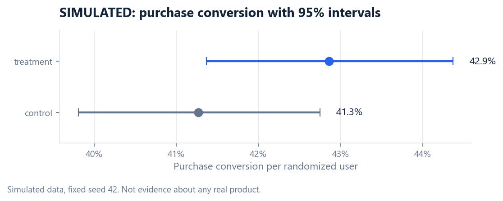

# Experiment memo: simplified checkout

> ## SIMULATED DATA
> The GA4 sample contains no randomized experiment. Sections 1 to 4 are a real experiment plan. Section 5 analyses **data generated by a random number generator** (notebook 05, seed 42, file `data/simulated/SIMULATED_checkout_ab_test.csv`). It shows how the analysis would be done. It is not evidence that any change improved the Google Merchandise Store.

**To:** Product manager, checkout  **From:** Product analytics  **Decision needed:** approve the test design below

## 1. Why test this

The funnel analysis shows users leaving between cart, checkout and purchase (see `executive_summary.md`, finding 1 and 2, once filled in with real numbers). Observational data shows *where* users leave, not *why*, and not whether a redesign would help. Only a randomized test can answer that.

## 2. Hypothesis

A simplified one-page checkout increases purchase conversion among users who begin checkout, without reducing revenue per user.

## 3. Design

| Item | Decision |
|---|---|
| Unit of randomization | User (so one person sees one version across sessions) |
| Eligibility | A user enters the test at their first `begin_checkout` event |
| Split | 50% control (current checkout), 50% treatment (simplified) |
| Primary metric | Purchase conversion per randomized eligible user |
| Guardrail metric | Revenue per randomized user must not fall |
| Baseline assumption | 40% of eligible users purchase. Replace with the measured checkout-to-purchase rate from Q19 before running |
| Minimum detectable effect | +3 percentage points absolute. Smaller lifts are judged not worth the build cost |
| Significance and power | alpha = 0.05 two-sided; power = 0.80 |
| Sample size | **4,234 users per group, 8,468 in total** |
| Duration | Until the sample size is reached, and at least two full weeks, to cover weekday patterns and let novelty fade |
| Analysis | Once, at the end. No stopping early on a good-looking interim result |

Sample size by detectable effect (same baseline, alpha and power):

| MDE | Users per group |
|---|---|
| +1 point | 37,827 |
| +2 points | 9,493 |
| **+3 points** | **4,234** |
| +5 points | 1,534 |

## 4. Decision rule, fixed in advance

- **Ship** if the primary metric is significant at 0.05, the whole 95% interval is above zero, and the guardrail shows no harm.
- **Do not ship** if the interval is entirely below zero or the guardrail is harmed.
- **Inconclusive** otherwise: extend the test or accept that any effect is smaller than the design could detect.

Checks before reading the result: sample-ratio mismatch (chi-square on the split), and that both groups have the same eligibility rule.

## 5. Result of the simulated run

*Simulated. True effect built into the generator: +3 points.*

| | Control | Treatment |
|---|---|---|
| Randomized users | 4,301 | 4,167 |
| Purchasers | 1,775 | 1,786 |
| Purchase conversion | 41.27% | 42.86% |
| Revenue per user | $24.68 | $25.73 |

| Check | Result |
|---|---|
| Sample-ratio mismatch | Not detected (chi-square p = 0.145) |
| Absolute lift | +1.59 points |
| 95% confidence interval | -0.51 to +3.69 points |
| Relative lift | +3.9% |
| z statistic, p-value | z = 1.48, p = 0.138 |
| Guardrail: revenue per user | +$1.05 (bootstrap 95% interval -$0.62 to +$2.61; Welch t-test p = 0.218) |

**Reading.** The result is **inconclusive**. The interval includes zero, so the test does not show the simplified checkout is better. The interval also includes the planned +3 points, so it does not show the change is ineffective either. Under the decision rule: do not ship on this evidence; extend or rerun.

**The instructive part.** The simulation was built with a true +3 point effect and a correctly sized test still missed it. That is what 80% power means: about one such test in five fails to detect a real effect of the planned size. "Not significant" must not be reported as "no effect". It also shows why the point estimate alone (+1.59) would mislead: the plausible range runs from a small loss to a lift of nearly 4 points.

## 6. Risks and how the real test would handle them

| Risk | Mitigation |
|---|---|
| Novelty effect | Run at least two weeks; compare week 1 with week 2 |
| Sample-ratio mismatch | Check the split before anything else; a mismatch voids the test |
| Peeking | One planned analysis at full sample size |
| Multiple testing | One primary metric. Segment cuts are exploratory and labelled so |
| Seasonality | Avoid launching in the holiday peak; this dataset's period would be a poor baseline for February |
| Interference | Randomize by user, not session, so a person does not see both versions |
| Tracking differences | Verify both checkouts fire the same `purchase` event with a transaction id |

## 7. What happens next

1. Replace the 40% baseline with the measured rate and recompute the sample size (`metrics.sample_size_two_proportions`).
2. Estimate how many users begin checkout per week (from `fact_user_day`) to forecast the test duration.
3. Agree the MDE with the product manager: it is a business decision.
4. Run the test on a live product. Until then, no impact is claimed.
